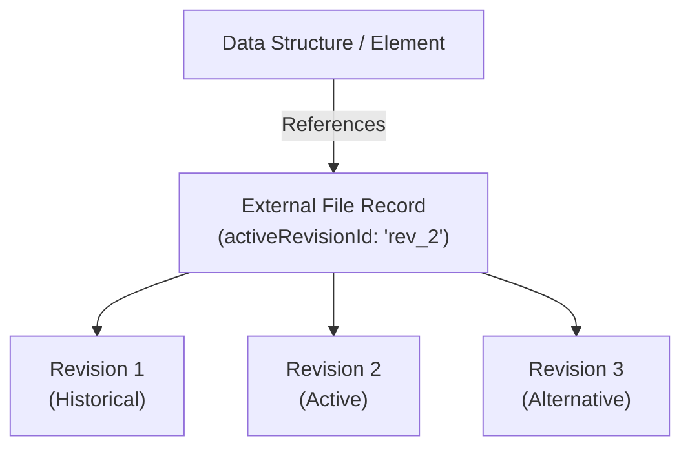

## Overview

Data structures across a `.duc` container (such as image elements, 3D model elements, vector PDF overlays, block definitions, project charters, or version checkpoints) frequently depend on binary files to function.

Embedding raw binary payloads directly inside structural records bloats document state and tightly couples data structures to binary payloads. `.duc` handles binary payload storage through **External Files** and **Deliberate Revisions**.

---

## Decoupling Payloads from Data Structures

An External File (`DucExternalFile`) records an asset's identity, revisions, and active payload. A revision can carry embedded bytes or an explicit local-file locator. Canvas elements, block definitions, and other data structures store only an `ExternalFileId` reference rather than embedding binary data directly.

### Separation of Concerns

1. **Structural Identity**: The referencing element or data structure maintains its coordinates, properties, attached issues, and charter links.
2. **Payload Storage**: Revision metadata identifies the payload, which is embedded in the container or resolved by the host from its explicit locator, independent of the referencing record.

This separation allows any data structure in `.duc`, not just canvas elements, to attach binary assets without altering its own record format or spatial identity.

---

## Local File Locators

A revision's optional `locator` identifies a native file without embedding its bytes:

```json
{ "kind": "relative", "path": "assets/building.ifc", "originalPath": "assets/building.ifc" }
```

```json
{ "kind": "absolute", "path": "/Users/jane/models/building.ifc" }
```

`kind` is explicit. A relative path resolves against the directory containing the owning `.duc`, never the process working directory. An absolute path names a rooted POSIX path, Windows drive path, or UNC share. Native `file:` URIs are normalized by the locator helpers. Percent escapes are decoded in file URIs; percent signs in native paths are preserved.

The host can preserve `originalPath` for relocation and user-facing recovery. Moving a drawing requires keeping relative asset locations valid or rebasing the locators. An absolute locator remains tied to the host path it names.

`ducjs`, `ducpy`, and `ducrs` expose locator resolution and preserve the metadata through serialization, including metadata-only reads. The SQLite container stores it in `external_file_locators`, keyed by revision. The locator does not grant filesystem access or upload permission; the application must enforce those permissions before reading bytes.

Resolution exposes these states:

| State | Meaning |
| --- | --- |
| `resolved` | A valid native target path was obtained; supplied existence and readability checks passed |
| `unresolved` | The locator is invalid or a relative locator has no owning `.duc` path |
| `missing` | The host's existence check could not find the target |
| `inaccessible` | The host's readability check could not access the target |

Without filesystem checks, `resolved` proves path resolution only. A host must still open the file successfully. Preserve the locator when a target is missing or inaccessible so the user can locate or authorize it.

A native link points to a file that can change outside the drawing. Hosts should compare the resolved bytes with the revision checksum and record a new active revision when adopting changed content. The locator alone does not preserve a historical copy of those external bytes.

## Generated Model Artifacts

A [Model Element](/docs/concepts/elements/model-element) references its generated artifact through `fileIds` and output metadata. The external revision carries the bytes; `customData.modelOutput` records the artifact file ID, renderer, content hash, source and input fingerprints, and generation identity. IFC preview data can use a separate external file.

Source inputs and generated output are separate references. Generated artifact and preview files must be excluded from runtime inputs so writing output cannot invalidate itself.

---

## Manual Revisions and Active Pointer

File updates in `.duc` are managed through **Revisions** (`revisions`).

### Deliberate Revision Triggers

A revision is created when a user or application adds one to an external file. Applications can record a source replacement, an adopted change to a linked file, or a regenerated model artifact. Ordinary drawing saves do not require a new revision for unchanged bytes.



### Active Revision Selection (`activeRevisionId`)

Adding a new revision does not automatically make it the active one. The most recent revision and the active revision are two separate ideas:

- **Explicit Active Pointer**: Each external file record stores an explicit `activeRevisionId`, which determines which revision is actually in use, regardless of which revision was added most recently.
- **Flexible Switching**: Users can switch or pin `activeRevisionId` to any revision in the file's history without deleting newer or older revisions.
- **Identity Preservation**: Switching `activeRevisionId` updates the rendered or evaluated asset while preserving all element IDs, annotations, and spatial coordinates intact.

---

## External Files vs. Enterprise PLM and Cloud Storage

External Files in `.duc` are designed to provide context to document structures, not to serve as an enterprise file centralization system.

It's tempting to describe the difference as "manual" versus "automatic" versioning, but that's not really the distinction that matters, plenty of PLM systems also rely on deliberate check-ins rather than continuous sync. The real difference is one of **purpose and selectivity**: what each system is trying to capture, and how much of a file's history it's willing to keep.

| System Type | Purpose | What Gets Kept |
| :--- | :--- | :--- |
| **Enterprise PLM / Cloud Drive** | Centralized repository for organizing and tracking file assets across an entire team or organization | A comprehensive record of a file's history, most edits and drafts along the way |
| **`.duc` External Files** | Provides binary payload context to a specific document data structure | Only the revisions deliberately chosen as meaningful checkpoints for that structure |

A PLM system exists because an organization needs a durable way to manage files across many people and processes over time. External Files exist for a narrower reason: so that a binary asset can be referenced from anywhere in the `.duc` data model, and so that reference can point to an explicit, known state of that file at a point in time. The revisions kept on a given external file are typically a small fraction of everything a PLM system would track for the same file, only the states that were worth carrying into review, iteration, or delivery make the cut.

`.duc` External Files are not a replacement for PLM or cloud storage, and are not meant to compete with either. The two are solving different problems.

In short, **external files and revisions exist for relational context, not for data centralization.**